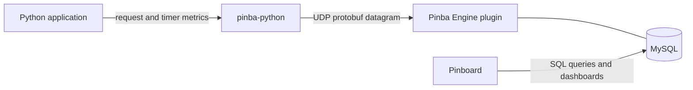

# pinba-python

[](https://github.com/XOlegator/pinba-python/actions/workflows/ci.yml)
[](https://pypi.org/project/pinba-python/)
[](https://github.com/XOlegator/pinba-python/releases/latest)
[](https://pypi.org/project/pinba-python/)
[](LICENSE)

Best-effort Pinba proto2 UDP instrumentation for Python 3.15+. This client sends request and timer metrics to [Pinba Engine](https://github.com/XOlegator/pinba_engine). One datagram is sent per sampled operation. Create one reporter **per worker after fork** and close it at shutdown; construction resolves DNS once. `sendto` is non-blocking and no queue or retry is used. A successful send only means that the local socket accepted the datagram, not that the engine received it.

## Where This Project Fits



- `pinba-python` collects metrics inside Python applications and sends one UDP datagram per sampled operation.
- [Pinba Engine](https://github.com/XOlegator/pinba_engine) receives packets and exposes metrics through MySQL tables.
- [Pinboard](https://github.com/intaro/pinboard) reads metrics from MySQL and provides dashboards.
- [Pinba Extension](https://github.com/XOlegator/pinba_extension) is the corresponding PHP client.

## Usage

```python
from pinba import PinbaMiddleware, Reporter, timed_block, record

reporter = Reporter("pinba-engine", 30002)
app = PinbaMiddleware(app, reporter, server_name="recommendations_api", sample_rate=0.1)

with timed_block({"group": "ai_naming", "category": "naming.registry"}):
    read_registry()
record(0.002, {"group": "ai_naming", "category": "naming.matches"})
# reporter.close() at worker shutdown
```

For non-HTTP work, use `with Collector('service', 'job', hostname).activate(reporter): ...`. `timed_block` and `record` use a ContextVar and are no-ops outside an active context. Context propagates through asyncio and threadpool helpers that copy context (such as Starlette `run_in_threadpool`); raw thread pools need `contextvars.copy_context()`. Each timer must have at least one tag. Request tags can be passed through `Collector(tags=...)`. Set low-cardinality tags only: never put secrets, identifiers, query strings or request IDs into tags.

HTTP duration begins at middleware entry and ends after the final `http.response.body` send completes, including streaming. On exception or cancellation before that point it ends during unwinding. Status and body bytes come from ASGI messages; absent status is omitted. Script is the HTTP method and route template, or `<unmatched>`; raw paths and query strings are never exported. Background tasks completing after the final body cannot change an already closed collector. `ru_utime`, `ru_stime`, and `memory_peak` are zero because process-wide usage cannot be attributed safely to concurrent requests.

`max_timers` defaults to 128, tag names and values are limited to 256 UTF-8 bytes, and datagrams to 1400 bytes. Oversized packets are dropped whole. Inspect `sent`, `errors`, `oversized`, and `dropped_timers` on the reporter; these are process-local counters. Configure limits for the actual network and compare sends to engine ingestion and `SHOW GLOBAL STATUS LIKE 'Pinba%'`. Sampling selects complete requests. Disabled integration should avoid constructing a reporter entirely. Measure latency, CPU and delivery before production use.

The bundled schema is shared with Pinba Engine and the PHP extension; regenerate bindings with `protoc -I src/pinba --python_out=src/pinba --pyi_out=src/pinba src/pinba/pinba.proto`. Run tests with `pip install -e '.[test]'` and `pytest` on Python 3.15. A live Engine and Pinboard integration test and production overhead measurements are still required.

## Installation

```sh
python -m pip install pinba-python
```

To install from a local checkout instead, run `python -m pip install .`.

## License

GNU Lesser General Public License v2.1 or later. See [LICENSE](LICENSE) and [NOTICE](NOTICE).
